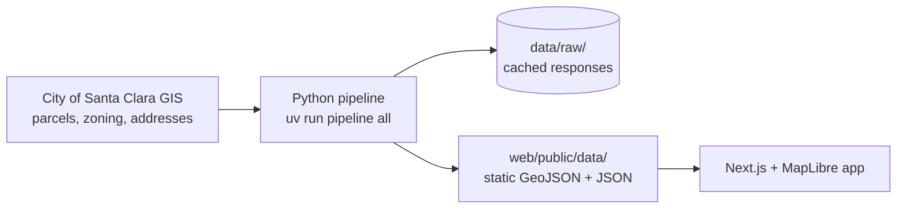

# SoftSite

**Live: https://softsite-sepia.vercel.app** · **A redevelopment screener for every parcel in Santa Clara, California.** SoftSite looks for "soft sites": parcels where current zoning allows much more than what's built today. Every number links back to its public source and retrieval date.

> **Status: v0 (Phase 1 of 8).** The parcel base map is live: zoning family, General Plan, specific-plan areas, historic and flood notes, lot area, year built, and address/APN search for all 27,706 parcels. Zoning capacity, scoring, the entitlement pipeline, AI site memos, and feasibility come in later phases.

*Screening tool only: not a zoning determination, legal advice, or an appraisal.*

## How it works



- **Pipeline** (`pipeline/`): pulls public data politely, checks it, computes lot areas in State Plane feet, and exports static files.
- **Web app** (`web/`): a static Next.js site that reads those files. There's no server-side database.

Design decisions are explained in plain English in [`docs/HOW_IT_WORKS.md`](docs/HOW_IT_WORKS.md). Every data source, its terms, and its known gaps are in [`docs/DATA_SOURCES.md`](docs/DATA_SOURCES.md).

## Run it locally

```bash
uv sync && uv run pytest          # pipeline + tests (Python 3.12 via uv)
uv run pipeline all               # fetch + process public data (~1 minute, polite rate limit)
npm --prefix web install
npm --prefix web run dev          # http://localhost:3000
```

## Data and license

Code is MIT-licensed (see [`LICENSE`](LICENSE)). Data comes from public sources, each under its own terms. The base map is © OpenStreetMap contributors via OpenFreeMap / OpenMapTiles. Parcel, zoning, and address data are © City of Santa Clara GIS.

Built by Henry Godtfredsen (Santa Clara University, Economics / Real Estate) with AI-assisted development.
